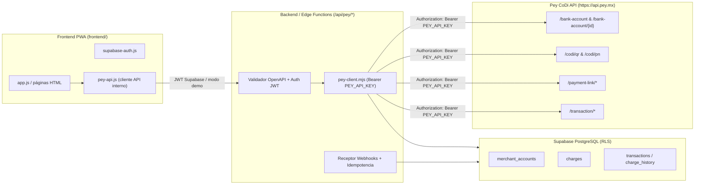

# Plan de Implementación: API de Pey (`pey-openapi.json`) en CobraVoz

Basado en la especificación `pey-openapi.json` (**CoDi API**, versión `2026-10-20`, entorno de producción `https://api.pey.mx`) y la arquitectura actual de **CobraVoz** (`HackatonMexico-4Sigma`).

---

## 1. Arquitectura y Reglas de Seguridad



1. **Aislamiento de credenciales (`dev-PublicApiLambdaAuthorizer`)**:
   - `PEY_API_KEY` **jamás** debe incluirse en `frontend/` (ya que `netlify.toml` publica `frontend/` de forma estática y `frontend/sw.js` precachea archivos públicos).
   - Todas las solicitudes hacia `https://api.pey.mx` deben ejecutarse en el backend (servidor Node.js o Supabase Edge Functions) enviando `Authorization: Bearer ${PEY_API_KEY}`.
2. **Habilitación estricta de CoDi**:
   - Según `pey-openapi.json`, `POST /codi/qr` y `POST /codi/pn` requieren que la cuenta bancaria asociada tenga `codiStatus: "ACTIVE"` (`status = 'activa'` en `public.merchant_accounts`). Mientras permanezca en `PENDING`, `PROCESSING` o `ERROR`, solo se permite consultar el estado o usar el flujo de demostración.

---

## 2. Cobertura de Endpoints de `pey-openapi.json`

| Dominio | Método y Ruta en Pey | Uso en CobraVoz | Códigos de respuesta y errores clave |
| :--- | :--- | :--- | :--- |
| **Cuentas Bancarias** | `POST /bank-account` | Alta de CLABE (`18` dígitos), `alias`, `name`, `entity` (`"PERSON"` \| `"BUSINESS"`) al finalizar el paso `bankForm` / `review`. | `200` (`{ id, codiStatus: "PENDING" }`), `400` (`INVALID_CLABE`, `INCOMPLETE_PARAMETERS`, `INVALID_PARAMETER`), `500`, `503` |
| **Cuentas Bancarias** | `GET /bank-account/{id}` | Consulta de estado CoDi (`PENDING`, `PROCESSING`, `ACTIVE`, `ERROR` + `errorMessage`) para habilitar cobros reales. | `200`, `400`, `404` (`BANK_ACCOUNT_NOT_FOUND`), `500`, `503` |
| **CoDi QR** | `POST /codi/qr` | Generación de QR CoDi desde voz o calculadora (`amount >= 0`, `concept`, `expiration === 0 \|\| >= 360`, `numRef` `^[0-9]{1,7}$`, `generateImage`, `bankAccountId`, `metadata`). | `201` (`{ id, qrString, qrImage }`), `400` (`INVALID_AMOUNT`, `INVALID_PARAMETER`, `INVALID_STATE`, `PEY_CONSISTENCY_ERROR`), `500`, `503` |
| **CoDi Push (PN)** | `POST /codi/pn` | Cobro directo al celular de 10 dígitos (`amount` `(0, 1000000]`, `phoneNumber` `^[0-9]{10}$`, `expiration >= 360`, `numRef`, `bankAccountId`, `metadata`). | `200` (`{ transactionId, codiId }`), `400`, `500`, `503` |
| **Payment Links** | `POST /payment-link/create` | Creación de liga de pago (`amount > 0`, `successUrl` HTTPS, `backUrl` HTTPS, `hasTip`, `clientReferenceId`, `metadata`). | `200` (`{ id, url }`), `400` (`INVALID_URL`, `INVALID_AMOUNT`), `500` |
| **Payment Links** | `POST /payment-link/update` | Actualización de importe (`{ paymentLinkId, amount }`, `additionalProperties: false`) solo mientras `status === 'pending'`. | `200` (`{ id, amount }`), `400`, `403`, `404`, `409` (`PAYMENT_LINK_NOT_PENDING`, `CONCURRENT_UPDATE`), `500` |
| **Payment Links** | `GET /payment-link/{id}` | Consulta de estado de liga (`pending`, `processing`, `paid`, `partial`) y sus `transactions[]`. | `200`, `400`, `403`, `404`, `500` |
| **Transacciones** | `GET /transaction/{id}` | Consulta de transacción individual por ULID (`status`: `"PENDING"` \| `"PAID"`, `amountBreakdown`, `payableType`, `payableId`). | `200`, `400`, `404`, `500` |
| **Transacciones** | `GET /transaction/codi/qr/{id}` | Consulta de transacciones asociadas al `IDC` de un QR CoDi (`20` por página, `nextToken`). | `200` (`{ items, nextToken }`), `400`, `404`, `500` |
| **Transacciones** | `GET /transaction/bank-account/{id}` | Historial de transacciones pagadas de una cuenta bancaria (`80` por página, `nextToken`). | `200` (`{ items, nextToken }`), `400`, `404`, `500`, `503` |
| **Transacciones** | `GET /transaction/api-key` | Conciliación global de transacciones del API key (`80` por página, `nextToken`). | `200` (`{ items, nextToken }`), `400`, `500` |

---

## 3. Fases de Implementación Paso a Paso

### Fase 1: Migración de Base de Datos (Supabase / PostgreSQL)
**Archivo propuesto**: `supabase/migrations/20261114153000_pey_api_integration.sql`.

Las migraciones preliminares `20261114140000_auth_and_protected_schema.sql` y `20261114141600_preliminary_entities.sql` se retiraron del repositorio. Antes de aplicar esta fase se debe definir el esquema base en el entorno de destino; los nombres de tablas siguientes son una propuesta, no tablas creadas por esta publicación.
1. **`public.merchant_accounts`**:
   - Añadir columnas:
     - `pey_bank_account_id text unique` (ULID devuelto por `POST /bank-account`).
     - `alias text not null default 'Cuenta Principal'` (`1..255` caracteres).
     - `error_message text` (poblado cuando `codiStatus === 'ERROR'`).
     - `pey_created_at timestamptz` (mapeado desde `dateCreated` Unix timestamp).
   - Mapear estados de Pey (`PENDING` -> `'pendiente'`, `PROCESSING` -> `'en_proceso'`, `ACTIVE` -> `'activa'`, `ERROR` -> `'error'`).
2. **`public.charges`**:
   - Añadir columnas para soportar los 3 medios de cobro de Pey (`API_CODI_QR`, `API_CODI_PN`, `PAYMENT_LINK`):
     - `charge_type text not null default 'API_CODI_QR' check (charge_type in ('API_CODI_QR', 'API_CODI_PN', 'PAYMENT_LINK'))`
     - `pey_qr_id text unique` (`id` / `IDC` devuelto por `POST /codi/qr`)
     - `pey_codi_id text` (`codiId` de 20 dígitos devuelto por `POST /codi/pn`)
     - `pey_transaction_id text` (`transactionId` ULID devuelto por `POST /codi/pn`)
     - `pey_payment_link_id text unique` (`id` ULID devuelto por `POST /payment-link/create`)
     - `payment_link_url text` (`url` devuelta por `POST /payment-link/create`)
     - `num_ref text not null default '0' check (num_ref ~ '^[0-9]{1,7}$')`
     - `payer_phone text check (payer_phone is null or payer_phone ~ '^[0-9]{10}$')`
     - `metadata jsonb not null default '{}'::jsonb`
3. **`public.transactions`**:
   - Añadir columnas de conciliación con Pey:
     - `pey_transaction_id text unique` (ULID de transacción en Pey)
     - `payment_method text check (payment_method in ('CODI', 'CARD'))`
     - `payable_type text check (payable_type in ('PAYMENT_LINK', 'API_CODI_QR', 'API_CODI_PN'))`
     - `payable_id text`
     - `base_cents bigint`, `tip_cents bigint default 0`, `fee_cents bigint default 0`, `application_fee_cents bigint`
     - `tracking_key text` (`metadata.trackingKey` de Banxico)
   - Conservar RLS activo y permisos de solo lectura (`SELECT`) para `authenticated` y escritura exclusiva del backend.

---

### Fase 2: SDK y Validadores de Contrato OpenAPI (`backend/pey/`)
**Archivos a crear**:
1. `HackatonMexico-4Sigma/backend/pey/pey-validators.mjs`:
   - Validadores puros sin dependencias externas que hacen cumplir exactamente las reglas de `pey-openapi.json` antes de enviar solicitudes a Pey:
     - `validateBankAccountPayload({ alias, name, clabe, entity })`: valida `alias` (`1..255`), `name` (`1..255`), `clabe` (`^[0-9]{18}$` + dígito verificador CLABE), `entity` (`"PERSON"` | `"BUSINESS"`, normalizando `'person'`/`'business'`).
     - `validateCodiQrPayload({ amount, concept, expiration, numRef, generateImage, bankAccountId, metadata })`: valida `amount >= 0`, `expiration === 0 || (Number.isInteger(expiration) && expiration >= 360)`, `numRef` (`^[0-9]{1,7}$`), `metadata` (máx. 50 pares, claves `<= 40` chars, valores escalares `<= 500` chars convertidos a string).
     - `validateCodiPnPayload({ amount, phoneNumber, concept, expiration, numRef, bankAccountId, metadata })`: valida `amount > 0 && amount <= 1000000`, `phoneNumber` (`^[0-9]{10}$`), `expiration >= 360`.
     - `validatePaymentLinkCreatePayload({ amount, successUrl, backUrl, hasTip, clientReferenceId, metadata })`: valida `amount > 0`, `successUrl` y `backUrl` con esquema `https://`, `clientReferenceId <= 255` chars.
     - `validatePaymentLinkUpdatePayload(body)`: valida que **únicamente** existan las propiedades `paymentLinkId` y `amount > 0` (`additionalProperties: false`), redondeando `amount` a 2 decimales (`round-half-up`).
2. `HackatonMexico-4Sigma/backend/pey/pey-client.mjs`:
   - Cliente HTTP del servidor hacia `https://api.pey.mx` (configurable vía `PEY_API_BASE_URL` y `PEY_API_KEY`, con inyección de `fetch` para pruebas).
   - Implementa los 11 métodos del OpenAPI:
     - `registerBankAccount(payload)` -> `POST /bank-account`
     - `getBankAccount(id)` -> `GET /bank-account/{id}`
     - `createCodiQr(payload)` -> `POST /codi/qr`
     - `createCodiPushNotification(payload)` -> `POST /codi/pn`
     - `createPaymentLink(payload)` -> `POST /payment-link/create`
     - `updatePaymentLink(payload)` -> `POST /payment-link/update`
     - `getPaymentLink(id)` -> `GET /payment-link/{id}`
     - `getTransaction(id)` -> `GET /transaction/{id}`
     - `getApiKeyTransactions({ nextToken })` -> `GET /transaction/api-key`
     - `getBankAccountTransactions(id, { nextToken })` -> `GET /transaction/bank-account/{id}`
     - `getCodiQrTransactions(id, { nextToken })` -> `GET /transaction/codi/qr/{id}`
   - Normalización de errores de Pey (`{ error: { message, type, requestId } }`) a una clase `PeyApiError(status, type, message, requestId)` con mensajes en español claros para el comerciante.

---

### Fase 3: Servidor / API Proxy e Idempotencia (`backend/server.mjs`)
**Archivo a crear**: `HackatonMexico-4Sigma/backend/server.mjs`
- Servidor HTTP ligero en Node.js (ejecutable con `node backend/server.mjs`) que expone rutas `/api/pey/*` consumidas por el frontend:
  - `POST /api/pey/bank-accounts` y `GET /api/pey/bank-accounts/:id`
  - `POST /api/pey/codi/qr` y `GET /api/pey/codi/qr/:id/transactions`
  - `POST /api/pey/codi/pn`
  - `POST /api/pey/payment-links`, `POST /api/pey/payment-links/update` y `GET /api/pey/payment-links/:id`
  - `GET /api/pey/transactions/:id`, `GET /api/pey/transactions` y `GET /api/pey/bank-accounts/:id/transactions`
- **Modo dual (Producción + Simulación Local)**:
  - Si `PEY_API_KEY` está configurada en el servidor, realiza las llamadas reales a `https://api.pey.mx`.
  - Si no está configurada, responde con un adaptador simulado determinista que cumple exactamente los esquemas de `pey-openapi.json` (`201` en `/codi/qr`, `200` en `/bank-account`, etc.) para desarrollo y pruebas sin exponer claves ni requerir cargos reales.

---

### Fase 4: Integración en el Frontend (`frontend/js/`)
**Archivos a crear/actualizar**:
1. **Crear `HackatonMexico-4Sigma/frontend/js/pey-api.js`**:
   - Cliente frontend que consume `/api/pey/*` adjuntando el token de sesión de `frontend/js/supabase-auth.js` y que hace fallback seguro a modo demostración cuando la app corre como vista previa estática pura en Netlify.
2. **Actualizar `frontend/js/app.js` y vistas en `frontend/pages/`**:
   - **Paso `review` / `ready` en `frontend/pages/registration.html`**:
     - Mapear `data.entity` (`'person'` -> `'PERSON'`, `'business'` -> `'BUSINESS'`) y registrar/consultar el estado `codiStatus` (`PENDING`, `PROCESSING`, `ACTIVE`, `ERROR`), mostrando el estado real o simulado y bloqueando la emisión de QR bancario real mientras `codiStatus !== 'ACTIVE'`.
   - **Pantalla de cobro y pago (`frontend/pages/charge.html`, `frontend/pages/payment.html`)**:
     - Al confirmar importe (`generateQR`), invocar `createCodiQr` con `{ amount, concept: data.description, expiration: 600, numRef, bankAccountId }` y almacenar `id` (`IDC`) y `qrString`.
     - Permitir consultar el estado del pago del QR mediante `getCodiQrTransactions(idc)` o transacción individual `getTransaction(transactionId)`.
   - **Actualizar `frontend/sw.js`**:
     - Añadir `./js/pey-api.js` a `ASSETS`, incrementar `CACHE` y mantener todas las rutas `/api/pey/*` excluidas del caché offline.

---

### Fase 5: Plan de Pruebas y Verificación (`tests/pey-api.test.mjs`)
**Archivo a crear**: `HackatonMexico-4Sigma/tests/pey-api.test.mjs` (ejecutable con `node --test`):
1. **Pruebas de validación de esquemas OpenAPI**:
   - `POST /codi/qr`: rechaza `amount < 0`, rechaza `expiration` entre `1` y `359` segundos, rechaza `numRef` no numérico o `> 7` dígitos, rechaza `metadata` con objetos anidados o `> 50` claves, y convierte valores escalares de `metadata` a strings.
   - `POST /codi/pn`: rechaza `amount <= 0` o `> 1000000`, rechaza `phoneNumber` que no sea exactamente de 10 dígitos (`^[0-9]{10}$`), exige `expiration >= 360`.
   - `POST /bank-account`: valida CLABE de 18 dígitos con dígito de control y `entity` en `["PERSON", "BUSINESS"]`.
   - `POST /payment-link/create` y `POST /payment-link/update`: exige HTTPS en `successUrl`/`backUrl`, rechaza campos adicionales en `update` (`additionalProperties: false`) y redondea `amount` a 2 decimales (`round-half-up`).
2. **Pruebas de cliente y manejo de errores HTTP**:
   - Verifica encabezados `Authorization: Bearer <token>`, serialización de respuestas `200`/`201` y mapeo de errores `400`, `403`, `404`, `409`, `500` y `503` (`SERVICE_UNAVAILABLE`, `PAYMENT_LINK_NOT_PENDING`, `BANK_ACCOUNT_NOT_FOUND`, `INVALID_CLABE`).
3. **Ejecución de toda la suite**:
   ```powershell
   node --test tests/*.test.mjs
   ```
